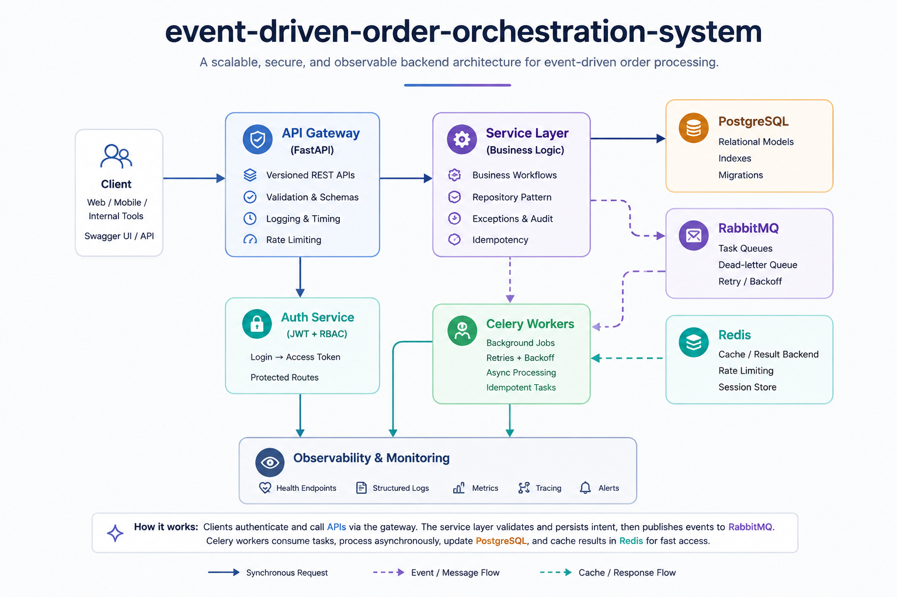

# Event-Driven Order Orchestration System

[](https://github.com/noohkhan7232/event-driven-order-orchestration-system/actions/workflows/ci.yml)


A production-style, event-driven backend that simulates how real e-commerce and logistics platforms process orders — where placing an order isn't one action, but a chain of independent steps (inventory, payment, shipping) that each need to succeed, fail, retry, or roll back on their own.

---

## The Problem

Most "order system" demo projects are a single `POST /orders` endpoint that writes one row to a database. That's not how order processing actually works at scale.

In a real system:

- **Inventory might be unavailable** by the time payment is attempted.
- **Payment might fail** after inventory has already been reserved.
- **A network retry or a double-click** can send the exact same order request twice — and naive systems create two orders and charge twice.
- **A background job can crash mid-task**, and if there's no retry or dead-letter handling, that order silently disappears.
- **API response time matters** — a client shouldn't have to wait 5+ seconds while inventory, payment, and shipping are processed synchronously inside one request.

These are the problems that separate a tutorial project from a system that could survive real traffic.

## The Solution

This educational backend demonstrates the following patterns and their current limitations:

| Problem | How this project solves it |
|---|---|
| Duplicate order requests (retries, double-clicks) | Order creation requires an `Idempotency-Key`; scope and payload checks are described in the project review. Consumers are not yet idempotent. |
| Slow, blocking order creation | The API commits the order and outbox intent together and returns 202; a relay publishes to RabbitMQ. All heavy work happens asynchronously. |
| Multi-step workflows that can partially fail | Order → inventory reservation → payment authorization → shipment creation is broken into discrete steps, each independently retryable, with compensation logic (e.g., releasing reserved inventory if payment fails). |
| Jobs that fail permanently | Exhausted retries persist failed jobs and compensate. Operator recovery reopens only technical failures with a fresh event; business failures cannot reopen. |
| "Is the system healthy?" | Health and metrics endpoints expose API state. The workers endpoint lists static queue and schedule configuration. |
| Access control | JWT-based authentication with role separation between customer, vendor, and admin. |

## How It Works (Architecture)

The current [reliability architecture and verification report](docs/reports/phase-2-report.md) documents the outbox, state machine, locking, retries, operations and real Docker experiments. The diagram below is the original workflow overview.



**Request flow:**

1. Client authenticates and receives a JWT.
2. Client sends `POST /orders` with an `Idempotency-Key`.
3. The API validates the request, checks the idempotency key, and persists the order as `created`.
4. The API publishes an `order.created` event to RabbitMQ and immediately returns a response — the client is never blocked waiting for fulfillment.
5. A Celery worker picks up the event and executes the workflow: reserve inventory → authorize payment → create shipment.
6. Each step updates PostgreSQL and emits audit log entries.
7. If a step fails, the worker retries with backoff; if retries are exhausted, failure details are logged to `failed_jobs` for investigation.
8. Redis backs Celery's result store; application read caching is not implemented.

This decouples the **API layer** (fast, synchronous, user-facing) from the **fulfillment layer** (slow, asynchronous, failure-tolerant) — which is the core idea behind event-driven backend design.

## Demo Video

Demo video: coming soon.

## 📖 Demo Explanation

For a detailed explanation of the demo and its workflow:

👉 [Read the Demo Video Explanation](docs/demo-video-explanation.md)


## Key Features

- JWT authentication and RBAC roles: customer, vendor, admin
- Idempotent order creation via `Idempotency-Key`
- Order history and lifecycle status tracking
- Inventory reservation, stock deduction, and release on failure
- Payment initiation, success/failure simulation, retry, and compensation workflows
- Shipment creation, shipment events, tracking status, and delayed shipment hooks
- RabbitMQ queues, Celery workers, scheduled jobs, retries, and dead-letter handling
- Audit logs and failed job persistence
- Structured JSON logging, request timing, health checks, metrics, and worker monitoring endpoints
- Full Docker Compose stack and pytest coverage for API/worker flows

## Technology Stack

| Area | Tools |
|---|---|
| API | Python 3.12, FastAPI, Pydantic |
| Database | PostgreSQL, SQLAlchemy ORM, Alembic |
| Async Processing | RabbitMQ, Celery workers, scheduled jobs |
| Cache / Results | Redis |
| Auth | JWT access tokens, password hashing, RBAC |
| DevOps | Docker, Docker Compose, Makefile, GitHub Actions |
| Quality | Pytest, API tests, worker flow tests, structured logging |

## Project Structure

```text
app/
  api/              FastAPI routers and route dependencies
  auth/             JWT security and protected-route helpers
  core/             config, logging, exceptions
  db/               SQLAlchemy session and metadata
  events/           event contracts and publisher helpers
  middleware/       request context and timing
  models/           order, inventory, payment, shipment, audit entities
  observability/    health and metrics helpers
  repositories/     database access layer
  schemas/          Pydantic request/response contracts
  services/         order, inventory, payment, shipping orchestration
  workers/          Celery app and task definitions
  tests/            pytest API and worker-flow tests
scripts/            demo data seeding
alembic/            migration history
docs/               architecture diagram, project review
```

## API Documentation

Swagger UI:

```text
http://127.0.0.1:8000/docs
```

OpenAPI JSON:

```text
http://127.0.0.1:8000/api/v1/openapi.json
```

### Authentication Example

```bash
curl -X POST http://localhost:8000/api/v1/auth/signup \
  -H "Content-Type: application/json" \
  -d '{"tenant_slug":"default","email":"customer@ordersapp.com","password":"CustomerPass123","full_name":"Demo Customer"}'
```

Log in at `POST /api/v1/auth/login` with email and password, then use the returned token:

```http
Authorization: Bearer <access_token>
```

### Create Order Request

```bash
curl -X POST http://localhost:8000/api/v1/orders \
  -H "Authorization: Bearer $TOKEN" \
  -H "Idempotency-Key: order-2026-0001" \
  -H "Content-Type: application/json" \
  -d '{"currency":"INR","items":[{"sku":"SKU-HEADPHONES","quantity":2}]}'
```

### Example Response

```json
{
  "id": "7bed0cac-dbc0-4137-986a-42bfada3e0bc",
  "status": "created",
  "total_amount": "99.98",
  "currency": "INR",
  "payments": [],
  "shipments": []
}
```

This is an abbreviated immediate HTTP 202 response. Fulfillment runs asynchronously; later reads can include payments and shipments. Retrying the same payload and key as the same customer returns the same order ID with its current status.

Operational endpoints:

```bash
curl http://localhost:8000/api/v1/system/health
curl http://localhost:8000/api/v1/system/metrics
curl http://localhost:8000/api/v1/system/workers
```

## Database Design Overview

Primary entities:

- `users` — authenticated platform actors with role assignments
- `orders` — order aggregate, idempotency key, and lifecycle state
- `order_items` — line items and SKU quantities
- `warehouses` — warehouse simulation data
- `inventory` — stock, reserved quantity, and low-stock state
- `payments` — payment transaction state and provider simulation result
- `shipments` — tracking number, carrier, and fulfillment status
- `shipment_events` — timestamped shipment lifecycle updates
- `audit_logs` — traceable workflow and correction events
- `failed_jobs` — exhausted retry/dead-letter diagnostics

Database practices demonstrated:

- UUID primary keys
- Foreign key relationships across order, payment, shipment, inventory, and audit records
- Indexes for idempotency key, order status, SKU, shipment tracking, and time-based lookups
- Alembic migrations in `alembic/versions`

## Docker Setup

```bash
cp .env.example .env
docker compose up --build
```

Services:

| Container | Purpose |
|---|---|
| `api` | FastAPI application |
| `worker` | Celery workers for order/inventory/payment/shipment queues |
| `scheduler` | Celery Beat scheduled jobs |
| `postgres` | PostgreSQL database |
| `redis` | Celery result backend |
| `rabbitmq` | Broker and management UI |

Initialize the database and demo data:

```bash
docker compose exec api alembic upgrade head
docker compose exec api python -m scripts.seed_demo
```

RabbitMQ management UI:

```text
http://localhost:15672
guest / guest
```

## Local Development

```bash
python -m venv .venv
source .venv/bin/activate
make install
make migrate
make seed
make run
```

Run a worker locally:

```bash
make worker
```

## Testing

```bash
make test
```

Test coverage includes:

- Authentication and order API behavior
- Health endpoint behavior
- Worker flow simulation
- Inventory reservation (see the hardening report for additional test evidence)

## Environment Variables

See [`.env.example`](.env.example). Important values:

- `DATABASE_URL`
- `TEST_DATABASE_URL`
- `REDIS_URL`
- `CELERY_BROKER_URL`
- `CELERY_RESULT_BACKEND`
- `SECRET_KEY` (at least 32 characters and not a known default outside local/development/test)
- `METRICS_TOKEN` (authenticate metrics/workers with this token or a platform-admin JWT in every environment; tenant-admin JWTs are denied)

## Project Review

An engineering self-review is available here: [`docs/project-review.md`](docs/project-review.md).

## Future Enhancements

- Split inventory/payment/shipping into independent services
- Payment gateway adapter layer
- OpenTelemetry traces across API and workers
- Warehouse allocation optimization
- Kafka event stream for analytics fan-out
- Admin DLQ replay and compensation dashboard

## License

This project is licensed under the MIT License — see the [LICENSE](LICENSE) file for details.

## Author

**NOOH KHAN**
[GitHub](https://github.com/noohkhan7232)

---

This project demonstrates backend and platform engineering signals that can be verified quickly: FastAPI APIs, PostgreSQL modeling, SQLAlchemy/Alembic, JWT/RBAC, RabbitMQ/Celery workflows, Redis, idempotency, compensation logic, Docker Compose, automated tests, metrics, and worker monitoring.
# Multi-tenant API quickstart (Phase 3A)

Each seller owns a tenant. JWT staff accounts manage catalog and inventory;
server integrations use scoped API keys. Customer signup now requires `tenant_slug`.
Owner email addresses remain globally unique. Public onboarding uses rate limits and
optional invite codes; captcha and email verification remain deferred.

Run from PowerShell 7 with Docker Desktop. Set `$env:API_PORT='18000'` if Windows
already reserves port 8000; otherwise the default is 8000.

```powershell
docker compose up --build -d
$port = if ($env:API_PORT) { $env:API_PORT } else { '8000' }
$base = "http://localhost:$port/api/v1"
curl.exe -sS "$base/tenants/register" -H 'Content-Type: application/json' -d '{"business_name":"Example Store","slug":"example-store","owner_email":"owner@example.com","owner_password":"replace-this-password","owner_name":"Owner"}'
$login = curl.exe -sS "$base/auth/login" -H 'Content-Type: application/json' -d '{"email":"owner@example.com","password":"replace-this-password"}' | ConvertFrom-Json
$jwt = "Authorization: Bearer $($login.access_token)"
curl.exe -sS "$base/products" -H $jwt -H 'Content-Type: application/json' -d '{"sku":"DEMO","name":"Demo product","price":"19.99","currency":"INR"}'
$warehouse = curl.exe -sS "$base/inventory/warehouses" -H $jwt -H 'Content-Type: application/json' -d '{"code":"MAIN","name":"Main warehouse","region":"local"}' | ConvertFrom-Json
$stock = @{sku='DEMO'; warehouse_id=$warehouse.id; available_quantity=20} | ConvertTo-Json -Compress
curl.exe -sS "$base/inventory" -H $jwt -H 'Content-Type: application/json' -d $stock
$created = curl.exe -sS "$base/api-keys" -H $jwt -H 'Content-Type: application/json' -d '{"name":"Order integration","scopes":["orders:read","orders:write"]}' | ConvertFrom-Json
# The full key is returned only here. Keep it in your server's secret store.
curl.exe -sS "$base/orders" -H "X-API-Key: $($created.key)" -H 'Idempotency-Key: demo-1' -H 'Content-Type: application/json' -d '{"items":[{"sku":"DEMO","quantity":3}],"external_reference":"shop-order-1"}'
# total_amount=59.97; worker progresses the order asynchronously.
```

Keys cannot manage users or other keys. Foreign tenant IDs return 404. Platform
administrators have no tenant and use `/api/v1/admin/tenants` to suspend/activate stores;
tenant owners cannot use those endpoints. Suspension blocks new requests immediately;
already accepted events continue processing.

Local demo seeding is `docker compose exec -T api python -m scripts.seed_demo`.
It creates distinct tenant-owner and platform-admin users, catalog/stock, and prints
one integration key only when creating it. Demo passwords in that script are public
local fixtures. Existing users are never automatically elevated.

Prices and names are snapshotted on order items. Unknown/archived SKUs, mixed
currencies, mismatched supplied currency, and unsupported totals are rejected before
persistence. Buyer fields stay on orders and are excluded from events and SQL logs.

Recovery uses `replay_failed_job(db, job_id, actor=operator_id, tenant_id=store_id)`;
only compensated `FAILED/RETRIES_EXHAUSTED` orders reopen. Provider adapters currently
use mocks only. Production-like environments require explicit `ALLOW_MOCK_PROVIDERS=true`.
`PROCESSED_EVENTS_RETENTION_DAYS` defaults to 30 and must exceed your maximum
redelivery/retry window. Failed jobs are retained until an explicit operator policy acts.

Run `python scripts/e2e_reliability.py` followed by `python scripts/e2e_tenancy.py`
for real-stack E1–E14 and supplements. These leave uniquely named test rows, restart
selected services, and the tenancy runner restores failure injection to false.
See [Phase 3A architecture and verification report](docs/reports/phase-3a-report.md).

### Request limits and registration controls

Phase 3B uses first-request fixed windows. Compose configures shared Redis on
logical DB2 with `RATE_LIMIT_REDIS_URL`; without a configured URL, local/dev/test
processes use memory. Memory windows are per process and are for local use.
Non-local deployments without Redis use the documented degraded behavior.

| Requests | Default quota | Identity |
|---|---|---|
| Login | 10/minute and 5/15 minutes | Socket IP; normalized email + IP |
| Tenant registration | 5/hour | IP |
| Customer signup | 10/hour | IP |
| Authenticated API | 600/minute across routes | API-key UUID or user UUID |
| Docs, health, readiness | 600/minute | IP |

Limits and windows have `RATE_LIMIT_*` settings in `.env.example`. A429 response
contains `Retry-After` seconds and `X-RateLimit-Limit/Remaining/Reset` (Unix seconds).
Successful quota headers describe the last applied policy; login applies both
IP and email+IP policies. Fixed windows permit boundary bursts, not a sliding quota.
Redis count/TTL updates are atomic; quota keys contain SHA256 digests, not emails,
IP addresses or credential plaintext.

Login/register/signup fail closed with503 when the limiter backend is unavailable.
Authenticated requests default to fail open (`RATE_LIMIT_FAIL_OPEN=true`); set it
false to return503 instead. Public health/docs remain available on backend failure.
Degradation emits `rate_limit_degraded_total` and a log containing policy/mode only.

`TRUSTED_PROXY_COUNT=0` ignores `X-Forwarded-For`. A positive value selects that
many entries from the right; malformed/short headers fall back to the socket peer.
Set this only behind a trusted proxy that sanitizes XFF and prevents direct access.
`REGISTRATION_ENABLED=false` closes new-store registration. Set optional
`REGISTRATION_INVITE_CODE` in a secret store to require an exact invite match;
it is never stored or returned by onboarding. Email verification/captcha remain deferred.
Tracking/SSE configuration and payment-webhook policies are reserved for their
future routes; those endpoints are not introduced by the rate-limiting task.

### Order status history

`order_timeline` records one initial row at intake and one row per accepted
transition/reopen. Each transition also writes an `order.status_changed` outbox
intent in the same transaction. The workflow consumer acknowledges those status
notifications without another transition. Replay and rolled-back operations add
no duplicate/committed history. Free-text reasons stay in private timeline/audit
records; events carry only declared reason codes or null.

Migration `0009_timeline` adds one synthetic observation for each existing order,
tagged `MIGRATION_BACKFILL` at migration time. It does not invent old transitions
or publish backfill events. Downgrade refuses operational timeline history until
it has been explicitly archived; never force-drop the journal to bypass that guard.

After starting the local stack with mock providers, run
`python scripts/verify_rate_timeline.py` for a real API/broker/worker/Redis smoke.
It checks quota headers, ordered history, four consumed status intents and
idempotent replay, and leaves uniquely named local verification rows.
Async payments, credentials and the Part 2 public surface are separate tasks.

### Tenant payment credentials

Tenant owners use JWT authentication for `PUT/GET/DELETE
/api/v1/settings/payments/razorpay`. API keys, vendors, customers and platform
administrators cannot manage these settings. PUT accepts key_id, key_secret,
webhook_secret and mode (test/live). Responses expose only the key ID's last four
characters, the public webhook identifier/URL, mode and active flag. DELETE
deactivates the configuration. The webhook URL is reserved until the inbound
payment webhook task is implemented; do not connect provider delivery yet.

Set `CREDENTIALS_ENCRYPTION_KEY` through your secret store to a Fernet key before
storing credentials, including locally. It is required outside local/dev/test.
No generated fallback key is persisted. Set `PUBLIC_BASE_URL` to your externally
reachable application origin (default http://localhost:8000).

For key rotation, deploy a comma-separated Fernet key ring with the new key first
and existing keys after it. MultiFernet encrypts new writes with the first key and
decrypts with all configured keys. In a controlled maintenance transaction, use
`CredentialVault.rotate()` on each key_secret_enc and webhook_secret_enc, verify
decryption under the new key, commit, and only then retire old keys from all
processes and the secret store. Retain keys required by backups. Never print keys,
decrypted credentials or tokens in commands/logs. The configuration migration
refuses downgrade while credential rows exist; archive them under your retention
policy before removing the table.
